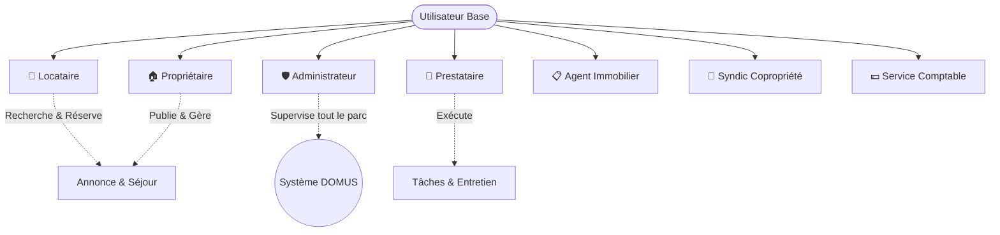

# 🏢 DOMUS — Système de Gestion de Location d'Appartements
> **Projet de Conception Orientée Objet (COO)** — Une plateforme full-stack moderne, sécurisée et modulaire pour la gestion locative immobilière, les réservations saisonnières, la gestion des états des logements, les interventions techniques et le suivi financier.

[](https://openjdk.org/)
[](https://spring.io/projects/spring-boot)
[](https://angular.dev/)
[](https://www.typescriptlang.org/)
[](https://tailwindcss.com/)
[](https://www.postgresql.org/)
[](https://jwt.io/)
[](./Conception)

---

## 📌 Sommaire
- [Vue d'ensemble](#-vue-densemble)
- [Fonctionnalités Principales & Modules Métier](#-fonctionnalités-principales--modules-métier)
- [Acteurs & Rôles](#-acteurs--rôles)
- [Architecture & Conception (UML)](#-architecture--conception-uml)
- [Structure du Dépôt](#-structure-du-dépôt)
- [Technologies & Stack Technique](#-technologies--stack-technique)
- [Sécurité, Guards & Authentification JWT](#-sécurité-guards--authentification-jwt)
- [Guide de Démarrage Rapide](#-guide-de-démarrage-rapide)
  - [Prérequis](#prérequis)
  - [1. Configuration de la Base de Données](#1-configuration-de-la-base-de-données)
  - [2. Démarrage du Backend (Spring Boot)](#2-démarrage-du-backend-spring-boot)
  - [3. Démarrage du Frontend (Angular)](#3-démarrage-du-frontend-angular)
- [Aperçu des Endpoints de l'API REST](#-aperçu-des-endpoints-de-lapi-rest)
- [Documentation & Livrables](#-documentation--livrables)

---

## 🌟 Vue d'ensemble

**DOMUS** est une application web d'envergure conçue dans le cadre du module **Conception Orientée Objet (COO)**. Elle répond aux problématiques réelles de gestion des biens immobiliers locatifs en automatisant l'intégralité du cycle de location :
1. **Mise en ligne et gestion des annonces** de biens immobiliers avec tarification intelligente.
2. **Cycle complet de réservation** (demande, vérification automatique de disponibilité, validation propriétaire/admin, annulation).
3. **Gestion financière sécurisée** (règlements en ligne, cautions/dépôts de garantie, quittances de loyer officielles).
4. **Suivi technique et cycle de vie des appartements** (libre, occupé, travaux / maintenance).
5. **Coordination opérationnelle avec des prestataires** (ménage, plomberie, réparations).
6. **Messagerie interne et système de notifications** contextuelles en temps réel entre utilisateurs.
7. **Outils décisionnels et rapports statistiques** pour l'administration et les propriétaires.

---

## 🚀 Fonctionnalités Principales & Modules Métier

| Module | Fonctionnalités Backend & Frontend | Interfaces Angular Associées |
| :--- | :--- | :--- |
| **🏠 Gestion des Annonces** | Publication, modification, suppression et catalogue des biens avec filtres et photos. | `/annonces`<br>`/annonces/nouvelle`<br>`/annonces/editer/:id` |
| **📅 Moteur de Réservations** | Réservation avec calcul des dates, acceptation/refus propriétaire, historique séjours. | `/reservations/mes-reservations`<br>`/reservations/nouvelle/:id`<br>`/reservations/annonce/:id` |
| **📈 Tarification Dynamique** | Tarifs saisonniers (Été, Hiver, etc.), calcul automatique du coût par nuitée et promotions. | `/annonces/:id/tarifications` |
| **💳 Paiements & Quittances** | Règlements multi-méthodes (CB, Virement, PayPal, Espèces), cautions et génération de quittances. | `/reservations/:id/paiements` |
| **🔧 Suivi de l'État des Logements** | État en vigueur (`LIBRE`, `OCCUPE`, `EN_MAINTENANCE`), suivi d'inspections et historique. | `/annonces/:id/etats` |
| **🛠️ Gestion des Tâches** | Mandatement de prestataires, planification et suivi de progression (`PLANIFIEE`, `EN_COURS`, `TERMINEE`). | `/taches` |
| **💬 Messagerie & Notifications** | Échanges directs entre locataires et propriétaires, boîte de notifications unifiée. | `/communication` |
| **👥 Administration des Comptes** | Supervision du parc d'utilisateurs, gestion des privilèges et suppressions de comptes. | `/admin/utilisateurs` |
| **📊 Rapports & Statistiques** | Bilans périodiques (revenus, taux d'occupation, volume des réservations). | `/admin/rapports` |

---

## 👥 Acteurs & Rôles

Le système s'articule autour d'une matrice de rôles stricte gérée via Spring Security RBAC et protégée côté client par Angular `roleGuard` :



- **Locataire (`ROLE_LOCATAIRE`)** : Recherche des biens, réserve des séjours, paie en ligne, télécharge ses quittances et échange par messagerie.
- **Propriétaire (`ROLE_PROPRIETAIRE`)** : Publie ses annonces, valide les réservations, ajuste ses tarifs saisonniers, mandate des prestataires et suit ses revenus.
- **Administrateur (`ROLE_ADMINISTRATEUR`)** : Gouvernance complète de la plateforme, gestion des comptes utilisateurs, suppression d'annonces non conformes et génération de rapports.
- **Prestataire (`ROLE_PRESTATAIRE`)** : Consultation de son planning d'interventions et mise à jour de l'état d'avancement des tâches.
- **Agent Immobilier, Syndic & Service Comptable** : Acteurs partenaires intervenant dans la gestion des visites, parties communes et conformité comptable.

---

## 📐 Architecture & Conception (UML)

Conformément à la méthodologie **COO**, la conception du système a été rigoureusement modélisée avant la phase d'implémentation. Les sources PlantUML et rendus haute résolution sont disponibles dans le répertoire [`Conception/`](./Conception) :

- **Cas d'Utilisation** ([`Conception/Usecase/`](./Conception/Usecase)) : Délimitation des frontières du système et des interactions par acteur.
- **Diagramme de Classes** ([`Conception/Diagramme de classes/`](./Conception/Diagramme%20de%20classes)) : Modélisation structurelle du domaine métier, des relations d'héritage (`Utilisateur`) et d'associations.
- **Diagramme de Séquence** ([`Conception/Diagramme de sequence/`](./Conception/Diagramme%20de%20sequence)) : Cinématique des flux d'authentification et de réservation (boîte noire / dynamique).
- **Diagramme d'Activité** ([`Conception/Diagramme d'Activite/`](./Conception/Diagramme%20d'Activite)) : Workflow complet de réservation, validation et paiement.
- **Diagramme d'États-Transition** ([`Conception/Diagramme d'états-transition/`](./Conception/Diagramme%20d'%C3%A9tats-transition)) : Cycle de vie d'une réservation et transition d'état d'un appartement.

---

## 📂 Structure du Dépôt

```
DOMUS/
├── Conception/                          # Dossier de conception UML
│   ├── Diagramme d'Activite/            # Diagramme d'activité (.png, code .txt)
│   ├── Diagramme d'états-transition/    # Diagramme d'état (.png, code .txt)
│   ├── Diagramme de classes/            # Diagramme de classes métier (.png, code .txt)
│   ├── Diagramme de sequence/           # Diagramme de séquence (.png, code .txt)
│   └── Usecase/                         # Diagramme de cas d'utilisation (.png, code .txt)
│
├── Documentation/                       # Documents de cadrage et livrables
│   ├── Cahier des Charges...docx        # Spécifications fonctionnelles détaillées
│   ├── Projet Description.txt           # Modélisation des tables et rôles
│   ├── Rapport.docx                     # Rapport technique et méthodologique
│   └── Système de Gestion...pptx        # Présentation de soutenance
│
├── domus-project/                       # 🟢 BACKEND Spring Boot 4 / Java 21
│   ├── src/main/java/com/achraf/domusproject/
│   │   ├── config/                      # Sécurité JWT, CORS (WebConfig), SecurityConfig
│   │   ├── controllers/                 # 10 Contrôleurs REST (Auth, Annonce, etc.)
│   │   ├── dto/                         # Request & Response Data Transfer Objects
│   │   ├── entities/                    # Entités JPA Hibernate
│   │   ├── enums/                       # Énumérations métier (Rôles, Statuts)
│   │   ├── repository/                  # Interfaces Spring Data JPA
│   │   └── service/                     # Logique métier et implémentations
│   ├── src/main/resources/              # application.properties & templates
│   ├── .env                             # Variables d'environnement locales
│   ├── pom.xml                          # Configuration Maven
│   └── README.md                        # Documentation détaillée Backend
│
└── domus-frontend/                      # 🔴 FRONTEND Angular 22 & Tailwind CSS
    ├── src/
    │   ├── app/
    │   │   ├── core/                    # Noyau transverse (Guards, Intercepteurs, Modèles, Services)
    │   │   │   ├── guards/              # role.guard.ts (Protection RBAC des routes)
    │   │   │   ├── interceptors/        # auth.interceptor.ts (Bearer token automatique)
    │   │   │   ├── models/              # Interfaces DTO TypeScript
    │   │   │   └── services/            # Services HTTP injectables (Auth, Annonce, etc.)
    │   │   ├── features/                # 10 modules fonctionnels avec interfaces dédiées
    │   │   │   ├── admin/user-list/
    │   │   │   ├── annonces/
    │   │   │   ├── auth/ (login, signup)
    │   │   │   ├── communication/
    │   │   │   ├── etats/
    │   │   │   ├── paiements/
    │   │   │   ├── rapports/
    │   │   │   ├── reservations/
    │   │   │   ├── taches/
    │   │   │   └── tarifications/
    │   │   ├── app.config.ts            # Configuration des providers et intercepteurs
    │   │   ├── app.routes.ts            # Table des routes et guards
    │   │   └── ...
    │   ├── environments/                # Configuration d'environnement (Dev/Prod)
    │   ├── styles.css                   # Directives globales Tailwind CSS
    │   └── main.ts                      # Point d'entrée Angular
    ├── package.json                     # Dépendances npm & scripts
    ├── tailwind.config.js               # Configuration du thème Tailwind CSS
    └── README.md                        # Documentation détaillée Frontend
```

---

## 💻 Technologies & Stack Technique

### Backend
- **Langage & Framework** : Java 21 LTS, Spring Boot 4.1.1
- **Sécurité** : Spring Security 6, JJWT (`io.jsonwebtoken` 0.11.5), Hachage BCrypt
- **ORM & Persistance** : Spring Data JPA, Hibernate, PostgreSQL Driver
- **Intégration Web** : Configuration CORS native via `WebConfig.java` (`http://localhost:4200`)
- **Productivité & Config** : Lombok, `spring-dotenv` (chargement `.env`)
- **Gestionnaire de dépendances** : Apache Maven (wrapper `mvnw` inclus)

### Frontend
- **Framework Web** : Angular 22 (Architecture Standalone Components)
- **Langage** : TypeScript 6.0
- **Contrôle d'accès** : Guard fonctionnel `roleGuard` avec vérification dynamique des rôles
- **Design & Ergonomie** : Tailwind CSS 3.4, PostCSS, Autoprefixer
- **Communication Réseau** : Angular `HttpClient` avec intercepteur automatique `authInterceptor`
- **Programmation Réactive** : RxJS 7.8
- **Tests Unitaires** : Vitest & JSDOM

---

## 🔒 Sécurité, Guards & Authentification JWT

L'application implémente un modèle d'authentification **Stateless** basé sur des JSON Web Tokens (JWT) :
1. L'utilisateur s'enregistre via `POST /api/auth/inscription` ou s'authentifie via `POST /api/auth/login`.
2. Le backend valide les identifiants et génère un jeton signé avec l'algorithme HMAC-SHA256, incluant les claims et le rôle.
3. Le client Angular stocke le token dans `localStorage` et le transmet automatiquement dans chaque requête via `authInterceptor` :
   ```http
   Authorization: Bearer <votre_token_jwt>
   ```
4. Côté Angular, `roleGuard` filtre la navigation en vérifiant les rôles autorisés sur chaque route avant d'autoriser l'affichage du composant.
5. Côté Spring Boot, `JwtAuthenticationFilter` intercepte la requête, valide la signature et peuple le `SecurityContextHolder`.

---

## ⚡ Guide de Démarrage Rapide

### Prérequis
- **JDK 21** ou supérieur installé ([Lien de téléchargement](https://adoptium.net/))
- **Node.js 20+** et **npm** installés ([Lien de téléchargement](https://nodejs.org/))
- **PostgreSQL 14+** en cours d'exécution localement ou via Docker

---

### 1. Configuration de la Base de Données

Créez une base de données PostgreSQL dédiée :
```sql
CREATE DATABASE domus_db;
```

Vérifiez ou adaptez le fichier `domus-project/.env` :
```properties
DB_URL=jdbc:postgresql://localhost:5432/domus_db
DB_USERNAME=postgres
DB_PASSWORD=votre_mot_de_passe
JWT_SECRET=147e71706f7d4c5de8c1d61051a2884b6e42552394899ec6e43352d1d577ee9e
JWT_EXPIRATION=86400000
```

---

### 2. Démarrage du Backend (Spring Boot)

Ouvrez un terminal dans le dossier `domus-project` :
```bash
cd domus-project

# Sous Windows (PowerShell / CMD)
.\mvnw.cmd spring-boot:run

# Sous Linux / macOS
./mvnw spring-boot:run
```
> Le serveur démarre sur **`http://localhost:8080`**. Au premier lancement, Hibernate génère automatiquement l'ensemble des tables relationnelles.

---

### 3. Démarrage du Frontend (Angular)

Dans un second terminal, rendez-vous dans `domus-frontend` :
```bash
cd domus-frontend

# Installation des dépendances
npm install

# Lancement du serveur de développement
npm start
# ou : npx ng serve
```
> Accédez à l'application web dans votre navigateur sur **`http://localhost:4200`**.

---

## 📡 Aperçu des Endpoints de l'API REST

Tous les endpoints sont préfixés par `/api` :

| Préfixe | Rôles Autorisés | Description |
| :--- | :--- | :--- |
| `POST /api/auth/inscription` | Public | Création d'un nouveau compte |
| `POST /api/auth/login` | Public | Authentification et obtention du token JWT |
| `GET, POST, PUT, DELETE /api/annonces` | Public / `PROPRIETAIRE` | Consultation et gestion des annonces |
| `POST, PATCH, GET /api/reservations` | `LOCATAIRE`, `PROPRIETAIRE`, `ADMIN` | Gestion du cycle de vie des réservations |
| `POST, GET /api/paiements` | `LOCATAIRE`, `PROPRIETAIRE`, `ADMIN` | Traitement des paiements et remboursements |
| `GET /api/paiements/{id}/quittance` | `LOCATAIRE`, `PROPRIETAIRE`, `ADMIN` | Téléchargement de la quittance de loyer |
| `POST, GET /api/etats` | `PROPRIETAIRE`, `ADMINISTRATEUR` | Mise à jour et historique d'état des logements |
| `POST, GET, DELETE /api/tarifications` | `PROPRIETAIRE`, `ADMINISTRATEUR` | Tarifs saisonniers et calcul de prix |
| `POST, PUT, GET /api/taches` | `PROPRIETAIRE`, `PRESTATAIRE`, `ADMIN` | Assignation et suivi des interventions |
| `POST, GET /api/communication/message` | Authentifié | Envoi et réception de messages directs |
| `GET, DELETE /api/utilisateurs` | `ADMINISTRATEUR` | Supervision et gestion des comptes utilisateurs |
| `POST, GET /api/rapports` | `ADMINISTRATEUR` | Génération de statistiques et rapports globaux |

👉 *Pour les détails techniques complets, consultez :*
- 📗 [**README du Backend (`domus-project/README.md`)**](./domus-project/README.md)
- 🎨 [**README du Frontend (`domus-frontend/README.md`)**](./domus-frontend/README.md)

---

## 📚 Documentation & Livrables

Tous les documents académiques et techniques du projet sont regroupés dans le dossier [`Documentation/`](./Documentation) :
- 📄 **Cahier des Charges** : Besoins métiers, règles de gestion et périmètre.
- 📘 **Rapport de Conception** : Démarche objet, patrons de conception et architecture.
- 📊 **Présentation** : Diaporama récapitulatif du projet pour la soutenance.
- 📐 **Diagrammes UML** : Disponibles en code source modifiable dans [`Conception/`](./Conception).

---

## 👨‍💻 Auteur

- **Achraf** — *Projet Conception Orientée Objet (COO)*
