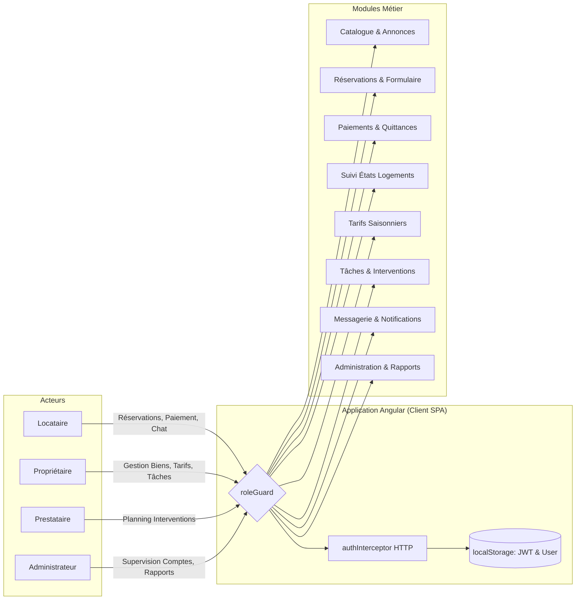

# 🎨 DOMUS Frontend — Client Web Angular 22 & Tailwind CSS

> **Application Single-Page (SPA) moderne et modulaire pour le système DOMUS**, développée avec Angular 22 (Standalone Components) et stylisée avec Tailwind CSS. Elle intègre un contrôle d'accès strict par rôles (`roleGuard`), une injection automatique de jetons JWT via `authInterceptor`, et une couverture complète des fonctionnalités métier pour tous les acteurs (Locataires, Propriétaires, Prestataires, Administrateurs).

[](https://angular.dev/)
[](https://www.typescriptlang.org/)
[](https://tailwindcss.com/)
[](https://rxjs.dev/)
[](https://vitest.dev/)

---

## 📌 Sommaire
- [Vue d'ensemble](#-vue-densemble)
- [Fonctionnalités & Modules Métier](#-fonctionnalités--modules-métier)
- [Tableau des Routes & Matrice des Permissions (Role Guard)](#-tableau-des-routes--matrice-des-permissions-role-guard)
- [Architecture & Organisation du Code](#-architecture--organisation-du-code)
- [Services Angular Injectables & API Endpoints](#-services-angular-injectables--api-endpoints)
- [Modèles TypeScript DTO](#-modèles-typescript-dto)
- [Sécurité, Guards & Intercepteur JWT](#-sécurité-guards--intercepteur-jwt)
- [Configuration des Environnements & CORS](#-configuration-des-environnements--cors)
- [Installation, Scripts & Démarrage](#-installation-scripts--démarrage)
- [Design System & Intégration Tailwind CSS](#-design-system--intégration-tailwind-css)

---

## 🌟 Vue d'ensemble

Le frontend de **DOMUS** fournit une expérience utilisateur fluide, réactive et sécurisée, adaptée aux profils et responsabilités spécifiques de chaque utilisateur de la plateforme :



---

## 🚀 Fonctionnalités & Modules Métier

L'application est divisée en 10 modules fonctionnels autonomes situés dans `src/app/features/` :

| Module | Emplacement | Fonctionnalités Clés |
| :--- | :--- | :--- |
| **🔐 Authentification** | `features/auth/` | • Connexion (`LoginComponent`) avec stockage JWT.<br>• Inscription (`SignupComponent`) avec sélection du rôle (`LOCATAIRE`, `PROPRIETAIRE`, `PRESTATAIRE`, etc.). |
| **🏠 Annonces Immobilières** | `features/annonces/` | • Catalogue complet avec cartes interactives (`AnnonceListComponent`).<br>• Filtre "Mes annonces" pour propriétaires.<br>• Formulaire réactif de création et édition (`AnnonceFormComponent`). |
| **📅 Moteur de Réservations** | `features/reservations/` | • Réservation d'un bien avec sélection de dates et nb de voyageurs (`ReservationFormComponent`).<br>• Historique et annulation locataire (`ReservationLocataireComponent`).<br>• Validation/Refus par le propriétaire (`ReservationProprietaireComponent`). |
| **💳 Paiements & Quittances** | `features/paiements/` | • Règlement sécurisé (CB, Virement, PayPal, Espèces) via `GestionPaiementComponent`.<br>• Remboursement de caution / dépôt de garantie.<br>• Téléchargement et consultation de quittance de loyer officielle. |
| **🔧 Suivi de l'État des Logements** | `features/etats/` | • Visualisation de l'état actuel (`LIBRE`, `OCCUPE`, `EN_MAINTENANCE`).<br>• Historique complet des inspections et commentaires (`SuiviEtatComponent`). |
| **📈 Tarification Dynamique** | `features/tarifications/` | • Configuration des variations de prix selon les saisons (Été, Hiver, etc.) ou événements (`GestionTarificationComponent`).<br>• Calcul dynamique du tarif par date. |
| **🛠️ Tâches Prestataires** | `features/taches/` | • Assignation de missions de maintenance/ménage à des prestataires dédiés (`TacheListComponent`).<br>• Mise à jour du statut (`PLANIFIEE`, `EN_COURS`, `TERMINEE`). |
| **💬 Messagerie & Notifications** | `features/communication/` | • Chat direct et historique d'échanges entre utilisateurs (`MessagerieComponent`).<br>• Flux de notifications contextuelles avec marquage "lu". |
| **👥 Administration des Comptes** | `features/admin/user-list/` | • Gestion du parc d'utilisateurs (`UserListComponent`).<br>• Consultation des rôles et suppression de comptes administrateur. |
| **📊 Rapports & Statistiques** | `features/rapports/` | • Génération automatique de bilans d'activité (`RapportListComponent`).<br>• Analyse des revenus, du taux d'occupation et des réservations par période. |

---

## 🚦 Tableau des Routes & Matrice des Permissions (Role Guard)

L'accès aux différentes pages est contrôlé au niveau du routeur Angular (`app.routes.ts`) via le guard fonctionnel `roleGuard` (`src/app/core/guards/role.guard.ts`) :

| Route | Composant | Rôles Autorisés | Description |
| :--- | :--- | :--- | :--- |
| `/login` | `LoginComponent` | *Public* | Écran de connexion |
| `/inscription` | `SignupComponent` | *Public* | Création de compte |
| `/annonces` | `AnnonceListComponent` | *Public* | Consultation du catalogue des biens |
| `/annonces/:id` | `AnnonceFormComponent` | *Public / Authentifié* | Détails d'une annonce |
| `/annonces/nouvelle` | `AnnonceFormComponent` | `PROPRIETAIRE` | Publication d'un nouveau logement |
| `/annonces/editer/:id` | `AnnonceFormComponent` | `PROPRIETAIRE` | Modification d'une annonce |
| `/annonces/:idAnnonce/etats` | `SuiviEtatComponent` | *Authentifié* | Suivi technique et historique d'état |
| `/annonces/:idAnnonce/tarifications` | `GestionTarificationComponent` | `PROPRIETAIRE`, `ADMINISTRATEUR` | Configuration des tarifs saisonniers |
| `/reservations/mes-reservations` | `ReservationLocataireComponent` | `LOCATAIRE` | Carnet des réservations du locataire |
| `/reservations/nouvelle/:annonceId` | `ReservationFormComponent` | `LOCATAIRE` | Demande de réservation pour un bien |
| `/reservations/annonce/:idAnnonce` | `ReservationProprietaireComponent` | `PROPRIETAIRE`, `ADMINISTRATEUR` | Gestion des demandes sur une annonce |
| `/reservations/:idReservation/paiements` | `GestionPaiementComponent` | `LOCATAIRE`, `PROPRIETAIRE`, `ADMINISTRATEUR` | Paiement, cautions et quittances |
| `/taches` | `TacheListComponent` | `PROPRIETAIRE`, `PRESTATAIRE`, `ADMINISTRATEUR` | Assignation et suivi des interventions |
| `/communication` | `MessagerieComponent` | *Tous rôles authentifiés* | Échanges de messages et notifications |
| `/admin/utilisateurs` | `UserListComponent` | `ADMINISTRATEUR` | Supervision de tous les utilisateurs |
| `/admin/rapports` | `RapportListComponent` | `ADMINISTRATEUR` | Génération et consultation des rapports |

---

## 🏛️ Architecture & Organisation du Code

L'arborescence du frontend respecte scrupuleusement la séparation entre le noyau (`core`) et les vues métiers (`features`) :

```
domus-frontend/
├── src/
│   ├── app/
│   │   ├── core/                                # Noyau transverse (services, modèles, sécurité)
│   │   │   ├── guards/
│   │   │   │   └── role.guard.ts                # Protection des routes par rôle (CanActivateFn)
│   │   │   ├── interceptors/
│   │   │   │   ├── auth.interceptor.ts          # Intercepteur HTTP ajoutant le token Bearer
│   │   │   │   └── jwt-interceptor.ts
│   │   │   ├── models/                          # Interfaces TypeScript & DTOs
│   │   │   │   ├── annonce.model.ts
│   │   │   │   ├── auth.model.ts
│   │   │   │   ├── communication.model.ts
│   │   │   │   ├── etat-appartement.model.ts
│   │   │   │   ├── paiement.model.ts
│   │   │   │   ├── rapport.model.ts
│   │   │   │   ├── reservation.model.ts
│   │   │   │   ├── tache.model.ts
│   │   │   │   └── tarification.model.ts
│   │   │   └── services/                        # Services HTTP injectables (Singleton root)
│   │   │       ├── annonce.service.ts
│   │   │       ├── auth.service.ts
│   │   │       ├── communication.service.ts
│   │   │       ├── etat-appartement.service.ts
│   │   │       ├── paiement.service.ts
│   │   │       ├── rapport.service.ts
│   │   │       ├── reservation.service.ts
│   │   │       ├── tache-prestataire.service.ts
│   │   │       ├── tarification.service.ts
│   │   │       └── utilisateur.service.ts
│   │   │
│   │   ├── features/                            # Composants fonctionnels par domaine métier
│   │   │   ├── admin/user-list/                 # Supervision des utilisateurs
│   │   │   ├── annonces/
│   │   │   │   ├── annonce-form/                # Création / Édition d'annonces
│   │   │   │   └── annonce-list/                # Catalogue & filtre "Mes annonces"
│   │   │   ├── auth/
│   │   │   │   ├── login/                       # Page de connexion
│   │   │   │   └── signup/                      # Page d'inscription multi-rôle
│   │   │   ├── communication/pages/messagerie/  # Messagerie et notifications
│   │   │   ├── etats/pages/suivi-etat/          # Historique et déclaration d'état
│   │   │   ├── paiements/pages/gestion-paiement/# Paiement en ligne et quittances
│   │   │   ├── rapports/pages/rapport-list/     # Génération de statistiques
│   │   │   ├── reservations/pages/
│   │   │   │   ├── reservation-form/            # Demande de réservation
│   │   │   │   ├── reservation-locataire/       # Suivi locataire
│   │   │   │   └── reservation-proprietaire/    # Approbation propriétaire
│   │   │   ├── taches/pages/tache-list/         # Interventions de prestataires
│   │   │   └── tarifications/pages/gestion-tarification/ # Règles saisonnières
│   │   │
│   │   ├── app.config.ts                        # Configuration globale (Zone, Router, HttpClient)
│   │   ├── app.routes.ts                        # Table de routage et guards
│   │   ├── app.ts                               # Composant racine
│   │   ├── app.html                             # Layout global
│   │   └── app.css                              # Styles racines
│   │
│   ├── environments/                            # Configuration des URLs d'API
│   │   ├── environment.ts
│   │   └── environment.development.ts
│   ├── main.ts                                  # Point d'entrée Angular bootstrap
│   └── styles.css                               # Imports directives Tailwind CSS
│
├── angular.json                                 # Configuration Angular CLI
├── package.json                                 # Dépendances npm & scripts
├── tailwind.config.js                           # Configuration du thème Tailwind CSS
└── tsconfig.json                                # Options de compilation TypeScript
```

---

## 💉 Services Angular Injectables & API Endpoints

Tous les services communiquent avec le backend REST via Angular `HttpClient` :

| Service | Méthodes Principales | Endpoints Associés |
| :--- | :--- | :--- |
| **`AuthService`** | `login()`, `inscription()`, `logout()`, `estConnecte()`, `aLeRole()` | `POST /api/auth/login`<br>`POST /api/auth/inscription` |
| **`AnnonceService`** | `obtenirToutesAnnonces()`, `obtenirMesAnnonces()`, `creerAnnonce()`, `modifierAnnonce()`, `supprimerAnnonce()` | `GET/POST /api/annonces`<br>`GET /api/annonces/mes-annonces`<br>`PUT/DELETE /api/annonces/{id}` |
| **`ReservationService`**| `creerReservation()`, `obtenirMesReservations()`, `obtenirParAnnonce()`, `changerStatut()`, `annulerReservation()` | `POST /api/reservations`<br>`GET /api/reservations/mes-reservations`<br>`GET /api/reservations/annonce/{id}`<br>`PATCH /api/reservations/{id}/statut` |
| **`PaiementService`** | `effectuerPaiement()`, `obtenirParReservation()`, `telechargerQuittance()`, `rembourserDepot()` | `POST /api/paiements`<br>`GET /api/paiements/reservation/{id}`<br>`GET /api/paiements/{id}/quittance` |
| **`EtatAppartementService`** | `declarerNouvelEtat()`, `obtenirEtatActuel()`, `obtenirHistorique()` | `POST /api/etats`<br>`GET /api/etats/annonce/{id}/actuel`<br>`GET /api/etats/annonce/{id}/historique` |
| **`TarificationService`** | `ajouterTarification()`, `obtenirParAnnonce()`, `calculerPrix()`, `supprimerTarification()` | `POST /api/tarifications`<br>`GET /api/tarifications/annonce/{id}`<br>`GET /api/tarifications/annonce/{id}/prix` |
| **`TachePrestataireService`** | `assignerTache()`, `mettreAJourStatut()`, `obtenirTachesPrestataire()` | `POST /api/taches`<br>`PUT /api/taches/{id}/statut`<br>`GET /api/taches/prestataire/{id}` |
| **`CommunicationService`** | `envoyerMessage()`, `obtenirMessages()`, `obtenirNotifications()`, `marquerNotificationLue()` | `POST /api/communication/message`<br>`GET /api/communication/messages/{id}`<br>`GET /api/communication/notifications/{id}` |
| **`UtilisateurService`** | `obtenirTous()`, `supprimerCompte()` | `GET /api/utilisateurs`<br>`DELETE /api/utilisateurs/{id}` |
| **`RapportService`** | `genererRapport()`, `obtenirTous()` | `POST /api/rapports/generer`<br>`GET /api/rapports` |

---

## 🧩 Modèles TypeScript DTO

Tous les échanges de données sont typés par des interfaces strictes alignées sur les DTOs Spring Boot :

- **`annonce.model.ts`** : `AnnonceRequestDTO`, `AnnonceResponseDTO`
- **`auth.model.ts`** : `AuthRequestDTO`, `AuthResponseDTO`, `UtilisateurResponseDTO`, enum `Role`
- **`reservation.model.ts`** : `ReservationRequestDTO`, `ReservationResponseDTO`, enum `StatutReservation`
- **`paiement.model.ts`** : `PaiementRequestDTO`, `PaiementResponseDTO`, enum `MethodePaiement`, enum `StatutPaiement`
- **`etat-appartement.model.ts`** : `EtatAppartementRequestDTO`, `EtatAppartementResponseDTO`, enum `EtatType`
- **`tarification.model.ts`** : `TarificationRequestDTO`, `TarificationResponseDTO`, enum `Saison`
- **`tache.model.ts`** : `TacheRequestDTO`, `TacheResponseDTO`, enum `StatutTache`
- **`communication.model.ts`** : `MessageRequestDTO`, `MessageResponseDTO`, `NotificationDTO`
- **`rapport.model.ts`** : `RapportRequestDTO`, `RapportResponseDTO`, enum `TypeRapport`, enum `PeriodeRapport`

---

## 🔒 Sécurité, Guards & Intercepteur JWT

### 1. Intercepteur HTTP (`authInterceptor`)
Défini dans `src/app/core/interceptors/auth.interceptor.ts`, il intercepte toutes les requêtes HTTP sortantes et injecte le jeton d'authentification s'il est présent en mémoire :

```typescript
export const authInterceptor: HttpInterceptorFn = (req, next) => {
  const token = localStorage.getItem('token');

  if (token) {
    const cloned = req.clone({
      setHeaders: {
        Authorization: `Bearer ${token}`
      }
    });
    return next(cloned);
  }

  return next(req);
};
```

Il est configuré globalement dans `app.config.ts` :
```typescript
provideHttpClient(withInterceptors([authInterceptor]))
```

### 2. Guard Fonctionnel (`roleGuard`)
Défini dans `src/app/core/guards/role.guard.ts` :
1. Vérifie si l'utilisateur possède un token valide via `authService.estConnecte()`.
2. Si non connecté, redirige vers `/login` en conservant l'URL demandée (`returnUrl`).
3. Vérifie si le rôle de l'utilisateur correspond aux rôles autorisés sur la route (`route.data['roles']`).
4. Si l'accès est refusé, redirige automatiquement vers `/annonces`.

---

## 🌐 Configuration des Environnements & CORS

### Environnement Frontend
Le fichier `src/environments/environment.ts` pointe par défaut sur le serveur Spring Boot local :

```typescript
export const environment = {
  production: false,
  apiUrl: 'http://localhost:8080/api'
};
```

### Configuration CORS Backend
Le backend Spring Boot autorise les requêtes en provenance de `http://localhost:4200` via sa classe `WebConfig.java` :
- Méthodes acceptées : `GET`, `POST`, `PUT`, `DELETE`, `OPTIONS`.
- Support complet des en-têtes d'autorisation et des cookies de session si nécessaire.

---

## 💻 Installation, Scripts & Démarrage

### 1. Prérequis
- **Node.js** : version 20 LTS ou supérieure recommandée.
- **npm** : version 10+ ou 11+.

### 2. Installation
Depuis la racine du projet ou dans `domus-frontend` :
```bash
cd domus-frontend
npm install
```

### 3. Commandes Disponibles
| Commande | Action |
| :--- | :--- |
| `npm start` (ou `npx ng serve`) | Démarre le serveur local de dev sur **`http://localhost:4200`**. |
| `npm run build` | Compile l'application pour la production dans le répertoire `dist/`. |
| `npm run watch` | Compile et reconstruit à chaud à chaque modification de fichier. |
| `npm test` | Exécute la suite de tests unitaires avec le moteur **Vitest**. |

---

## 🎨 Design System & Intégration Tailwind CSS

- L'interface repose sur **Tailwind CSS 3.4**, garantissant un design moderne, épuré et entièrement responsive.
- Les directives utilitaires sont importées dans `src/styles.css` :
  ```css
  @tailwind base;
  @tailwind components;
  @tailwind utilities;
  ```
- Les composants exploitent des états interactifs élégants (`hover:scale-[1.02]`, `focus:ring-2`, micro-transitions fluides, ombres portées douces `shadow-sm` à `shadow-xl`, et badges de statuts aux couleurs adaptées).
