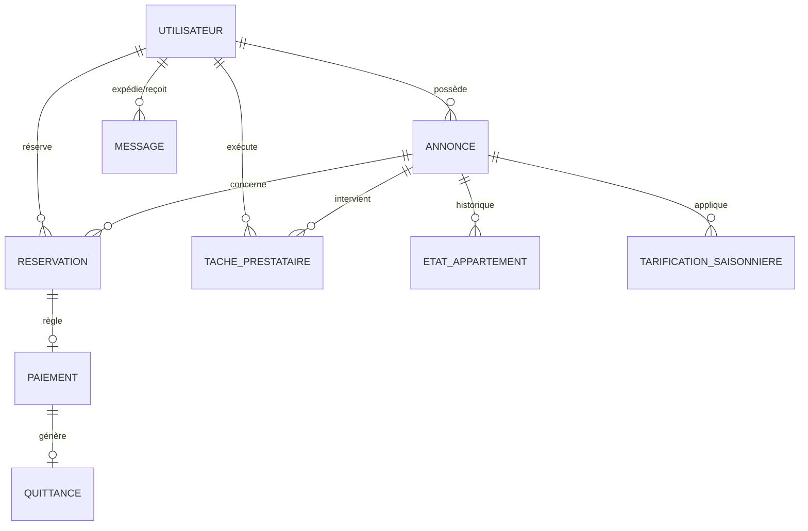

# ⚙️ DOMUS Backend API — Spring Boot 4 & Java 21

> **Moteur API RESTful du système DOMUS**, conçu selon les principes de la Conception Orientée Objet (COO) et architecturé en couches découplées avec sécurité par jeton JWT stateless, configuration CORS pour Angular, et persistance relationnelle PostgreSQL.

[](https://openjdk.org/)
[](https://spring.io/projects/spring-boot)
[](https://spring.io/projects/spring-security)
[](https://www.postgresql.org/)
[](https://jwt.io/)
[](https://projectlombok.org/)

---

## 📌 Sommaire
- [Architecture & Principes de Conception](#-architecture--principes-de-conception)
- [Modèle de Données & Entités JPA](#-modèle-de-données--entités-jpa)
- [Configuration & Variables d'Environnement](#-configuration--variables-denvironnement)
- [Configuration CORS (`WebConfig`)](#-configuration-cors-webconfig)
- [Matrice de Sécurité & Rôles](#-matrice-de-sécurité--rôles)
- [Référentiel Complet de l'API REST](#-référentiel-complet-de-lapi-rest)
  - [1. Authentification (`/api/auth`)](#1-authentification-apiauth)
  - [2. Annonces Immobilières (`/api/annonces`)](#2-annonces-immobilières-apiannonces)
  - [3. Réservations (`/api/reservations`)](#3-réservations-apireservations)
  - [4. Paiements & Quittances (`/api/paiements`)](#4-paiements--quittances-apipaiements)
  - [5. États des Appartements (`/api/etats`)](#5-états-des-appartements-apietats)
  - [6. Tarification Saisonnière (`/api/tarifications`)](#6-tarification-saisonnière-apitarifications)
  - [7. Tâches Prestataires (`/api/taches`)](#7-tâches-prestataires-apitaches)
  - [8. Communication & Notifications (`/api/communication`)](#8-communication--notifications-apicommunication)
  - [9. Utilisateurs & Administration (`/api/utilisateurs`)](#9-utilisateurs--administration-apiutilisateurs)
  - [10. Rapports & Statistiques (`/api/rapports`)](#10-rapports--statistiques-apirapports)
- [Installation, Compilation et Exécution](#-installation-compilation-et-exécution)
- [Tests](#-tests)

---

## 🏗️ Architecture & Principes de Conception

Le backend suit une **architecture en couches (N-Tier)** stricte assurant une forte cohésion et un faible couplage :

```
[ Contrôleurs REST ]  --> Reçoivent les requêtes HTTP, valident les entrées, retournent des ResponseEntity
        │
[ Couche DTO ]        --> Découplage strict entre entités JPA internes et payloads d'échange JSON
        │
[ Couche Service ]    --> Logique métier (interfaces Service + classes ServiceImpl)
        │
[ Couche Repository ] --> Accès aux données avec Spring Data JPA (Requêtes dérivées & JPQL)
        │
[ Entités JPA ]       --> Modélisation relationnelle avec annotations Jakarta Persistence
```

```
domus-project/
├── src/main/java/com/achraf/domusproject/
│   ├── config/                      # Sécurité JWT, WebConfig (CORS), SecurityConfig
│   │   ├── JwtAuthenticationFilter.java
│   │   ├── JwtService.java
│   │   ├── SecurityConfig.java
│   │   └── WebConfig.java           # Configuration CORS globale pour Angular (4200)
│   ├── controllers/                 # Contrôleurs REST (10 contrôleurs métier)
│   ├── dto/                         # Data Transfer Objects (Request & Response)
│   ├── entities/                    # Entités relationnelles JPA Hibernate
│   ├── enums/                       # Rôles, Statuts, Saisons, Types de rapports
│   ├── repository/                  # Repositories Spring Data JPA
│   └── service/                     # Interfaces et implémentations de logique métier
├── src/main/resources/              # application.properties & templates quittances
├── .env                             # Variables d'environnement locales
├── pom.xml                          # Dépendances Maven (Spring Boot 4, JJWT, PostgreSQL)
└── README.md
```

### Caractéristiques Techniques Clefs :
- **Java 21 LTS** : Utilisation des fonctionnalités modernes du langage.
- **DTO Pattern** : Les entités du domaine ne sont jamais directement exposées sur le réseau afin de prévenir toute fuite de données (ex: mot de passe haché) et surconsommation de bande passante.
- **Sécurité Déclarative** : Contrôle d'accès granulaire par méthode grâce à `@PreAuthorize("hasRole('...')")`.
- **Stateless Session** : L'API ne stocke aucun état de session sur le serveur (`SessionCreationPolicy.STATELESS`), facilitant la scalabilité horizontale.
- **Support Cross-Origin (CORS)** : Configuration WebMvc native pour interconnecter le client Angular (`http://localhost:4200`).

---

## 🗄️ Modèle de Données & Entités JPA

Le schéma relationnel est géré automatiquement par Hibernate (`spring.jpa.hibernate.ddl-auto=update`) :



### Énumérations du Domaine :
- `Role` : `LOCATAIRE`, `PROPRIETAIRE`, `ADMINISTRATEUR`, `PRESTATAIRE`, `AGENT_IMMOBILIER`, `SYNDIC`, `SERVICE_COMPTABLE`
- `StatutReservation` : `EN_ATTENTE`, `CONFIRMEE`, `ANNULEE`, `TERMINEE`
- `MethodePaiement` : `CARTE_BANCAIRE`, `VIREMENT`, `ESPECES`, `PAYPAL`
- `StatutPaiement` : `EN_ATTENTE`, `VALIDE`, `ECHOUE`, `REMBOURSE`
- `StatutQuittance` : `GENEREE`, `ENVOYEE`, `ANNULEE`
- `EtatType` : `LIBRE`, `OCCUPE`, `EN_MAINTENANCE`
- `Saison` : `ETE`, `HIVER`, `PRINTEMPS`, `AUTOMNE`
- `StatutTache` : `PLANIFIEE`, `EN_COURS`, `TERMINEE`
- `NotificationType` : `INFO`, `RESERVATION`, `PAIEMENT`, `MAINTENANCE`
- `TypeRapport` : `REVENUS`, `RESERVATIONS`, `DISPONIBILITES`
- `PeriodeRapport` : `MENSUEL`, `TRIMESTRIEL`, `ANNUEL`

---

## ⚙️ Configuration & Variables d'Environnement

L'application utilise le composant `spring-dotenv` pour charger les variables sensibles depuis un fichier `.env` situé à la racine du projet backend (`domus-project/.env`).

### Exemple de fichier `.env` :
```properties
# Base de données PostgreSQL
DB_URL=jdbc:postgresql://localhost:5432/domus_db
DB_USERNAME=postgres
DB_PASSWORD=votre_mot_de_passe_secret

# Sécurité & Token JWT
JWT_SECRET=147e71706f7d4c5de8c1d61051a2884b6e42552394899ec6e43352d1d577ee9e
JWT_EXPIRATION=86400000 # 24 heures en millisecondes
```

### `application.properties` :
```properties
spring.application.name=domus-project
spring.datasource.url=${DB_URL}
spring.datasource.username=${DB_USERNAME}
spring.datasource.password=${DB_PASSWORD}
spring.datasource.driver-class-name=org.postgresql.Driver

spring.jpa.hibernate.ddl-auto=update
spring.jpa.show-sql=true
spring.jpa.properties.hibernate.dialect=org.hibernate.dialect.PostgreSQLDialect
spring.jpa.properties.hibernate.format_sql=true

application.security.jwt.secret-key=${JWT_SECRET}
application.security.jwt.expiration=${JWT_EXPIRATION}
server.port=8080
```

---

## 🌐 Configuration CORS (`WebConfig`)

Le backend intègre une configuration CORS dédiée pour autoriser de manière fluide le client web Angular (`http://localhost:4200`) :

```java
package com.achraf.domusproject.config;

import org.springframework.context.annotation.Configuration;
import org.springframework.web.servlet.config.annotation.CorsRegistry;
import org.springframework.web.servlet.config.annotation.WebMvcConfigurer;

@Configuration
public class WebConfig implements WebMvcConfigurer {

    @Override
    public void addCorsMappings(CorsRegistry registry) {
        registry.addMapping("/api/**")
                .allowedOrigins("http://localhost:4200")
                .allowedMethods("GET", "POST", "PUT", "DELETE", "OPTIONS")
                .allowedHeaders("*")
                .allowCredentials(true);
    }
}
```

---

## 🔐 Matrice de Sécurité & Rôles

Les requêtes vers les endpoints protégés doivent impérativement inclure le header HTTP suivant :
```http
Authorization: Bearer <token_jwt>
```

| Rôle | Périmètre d'Action |
| :--- | :--- |
| **Public (Anonyme)** | Inscription, Login, Visualisation des annonces disponibles et tarification. |
| **`LOCATAIRE`** | Création de réservations, consultation de ses propres réservations, paiements, quittances, messagerie. |
| **`PROPRIETAIRE`** | Création et mise à jour de ses annonces, acceptation/refus des réservations, gestion des tarifs, déclaration d'état et assignation de tâches. |
| **`PRESTATAIRE`** | Consultation de ses interventions planifiées et mise à jour de leur statut. |
| **`ADMINISTRATEUR`** | Accès total : gestion de tous les comptes utilisateurs, suppression d'annonces, audits, génération de rapports globaux. |

---

## 📡 Référentiel Complet de l'API REST

### 1. Authentification (`/api/auth`)

#### 🔹 Inscription (`POST /api/auth/inscription`)
Crée un nouvel utilisateur dans le système.
- **Accès** : Public
- **Corps de requête** :
```json
{
  "nom": "Dupont",
  "prenom": "Jean",
  "email": "jean.dupont@example.com",
  "motDePasse": "MotDePasseFort123!",
  "telephone": "+33612345678",
  "adresse": "12 Avenue des Champs, Paris",
  "role": "LOCATAIRE"
}
```
- **Réponse HTTP 200** : Objet `UtilisateurResponseDTO` (sans mot de passe).

#### 🔹 Connexion (`POST /api/auth/login`)
Vérifie les identifiants et génère le token JWT.
- **Accès** : Public
- **Corps de requête** :
```json
{
  "email": "jean.dupont@example.com",
  "motDePasse": "MotDePasseFort123!"
}
```
- **Réponse HTTP 200** :
```json
{
  "token": "eyJhbGciOiJIUzI1NiIsInR5cCI6IkpXVCJ9...",
  "type": "Bearer",
  "utilisateur": {
    "id": 1,
    "nom": "Dupont",
    "prenom": "Jean",
    "email": "jean.dupont@example.com",
    "role": "LOCATAIRE"
  }
}
```

---

### 2. Annonces Immobilières (`/api/annonces`)

| Méthode | URL | Rôle Requis | Description |
| :--- | :--- | :--- | :--- |
| `GET` | `/api/annonces` | Public | Obtenir toutes les annonces disponibles |
| `GET` | `/api/annonces/{id}` | Public | Consulter les détails d'une annonce |
| `GET` | `/api/annonces/mes-annonces` | `PROPRIETAIRE` | Lister les annonces de l'utilisateur connecté |
| `POST` | `/api/annonces` | `PROPRIETAIRE` | Publier une nouvelle annonce |
| `PUT` | `/api/annonces/{id}` | `PROPRIETAIRE` | Mettre à jour une annonce existante |
| `DELETE`| `/api/annonces/{id}` | `PROPRIETAIRE`, `ADMINISTRATEUR` | Supprimer une annonce |

**Exemple de payload pour la création d'annonce (`POST`) :**
```json
{
  "titre": "Magnifique Studio Vue Tour Eiffel",
  "description": "Studio tout équipé avec balcon et vue panoramique.",
  "adresse": "15 Rue de Suffren",
  "ville": "Paris",
  "codePostal": "75007",
  "nombreDeChambres": 1,
  "superficie": 35.5,
  "prixParNuit": 120.00,
  "photos": "https://example.com/photos/1.jpg,https://example.com/photos/2.jpg",
  "caracteristiques": "Wifi, Climatisation, Balcon, Cuisine équipée"
}
```

---

### 3. Réservations (`/api/reservations`)

| Méthode | URL | Rôle Requis | Description |
| :--- | :--- | :--- | :--- |
| `POST` | `/api/reservations` | `LOCATAIRE` | Créer une réservation pour un séjour |
| `PATCH` | `/api/reservations/{id}/statut?statut=CONFIRMEE` | `PROPRIETAIRE`, `ADMINISTRATEUR` | Valider ou modifier le statut |
| `POST` | `/api/reservations/{id}/annuler` | `LOCATAIRE`, `PROPRIETAIRE` | Annuler une réservation |
| `GET` | `/api/reservations/mes-reservations` | `LOCATAIRE` | Lister l'historique des séjours du locataire |
| `GET` | `/api/reservations/annonce/{idAnnonce}` | `PROPRIETAIRE`, `ADMINISTRATEUR` | Lister les réservations liées à une annonce |

**Exemple de demande de réservation (`POST`) :**
```json
{
  "idAnnonce": 3,
  "dateDebut": "2026-11-01",
  "dateFin": "2026-11-07",
  "nombreDePersonnes": 2
}
```

---

### 4. Paiements & Quittances (`/api/paiements`)

| Méthode | URL | Rôle Requis | Description |
| :--- | :--- | :--- | :--- |
| `POST` | `/api/paiements` | `LOCATAIRE`, `ADMINISTRATEUR` | Enregistrer un paiement |
| `GET` | `/api/paiements/reservation/{idReservation}` | `PROPRIETAIRE`, `LOCATAIRE`, `ADMIN` | Historique des paiements d'une réservation |
| `GET` | `/api/paiements/{idPaiement}/quittance` | `PROPRIETAIRE`, `LOCATAIRE`, `ADMIN` | Générer/consulter la quittance officielle |
| `POST` | `/api/paiements/reservation/{idReservation}/rembourser-depot` | `PROPRIETAIRE`, `ADMINISTRATEUR` | Rembourser le dépôt de garantie |

---

### 5. États des Appartements (`/api/etats`)

| Méthode | URL | Rôle Requis | Description |
| :--- | :--- | :--- | :--- |
| `POST` | `/api/etats` | `PROPRIETAIRE`, `ADMINISTRATEUR` | Déclarer un nouvel état (`LIBRE`, `OCCUPE`, `EN_MAINTENANCE`) |
| `GET` | `/api/etats/annonce/{idAnnonce}/actuel` | Authentifié | Obtenir l'état en vigueur d'un bien |
| `GET` | `/api/etats/annonce/{idAnnonce}/historique` | Authentifié | Historique des transitions d'état |

---

### 6. Tarification Saisonnière (`/api/tarifications`)

| Méthode | URL | Rôle Requis | Description |
| :--- | :--- | :--- | :--- |
| `POST` | `/api/tarifications` | `PROPRIETAIRE`, `ADMINISTRATEUR` | Créer une règle de prix saisonnier |
| `GET` | `/api/tarifications/annonce/{idAnnonce}` | Public / Authentifié | Liste des tarifs spéciaux d'un bien |
| `GET` | `/api/tarifications/annonce/{idAnnonce}/prix?date=2026-12-25` | Public / Authentifié | Calcul dynamique du tarif pour une date |
| `DELETE`| `/api/tarifications/{id}` | `PROPRIETAIRE`, `ADMINISTRATEUR` | Supprimer une règle de tarification |

---

### 7. Tâches Prestataires (`/api/taches`)

| Méthode | URL | Rôle Requis | Description |
| :--- | :--- | :--- | :--- |
| `POST` | `/api/taches` | `PROPRIETAIRE`, `ADMINISTRATEUR` | Assigner une tâche (nettoyage, plomberie) |
| `PUT` | `/api/taches/{idTache}/statut` | `PRESTATAIRE`, `ADMINISTRATEUR` | Mettre à jour l'avancement (`EN_COURS`, `TERMINEE`) |
| `GET` | `/api/taches/prestataire/{idPrestataire}` | `PRESTATAIRE`, `ADMINISTRATEUR` | Planning des tâches du prestataire |

---

### 8. Communication & Notifications (`/api/communication`)

| Méthode | URL | Rôle Requis | Description |
| :--- | :--- | :--- | :--- |
| `POST` | `/api/communication/message` | Authentifié | Envoyer un message direct |
| `GET` | `/api/communication/messages/{idUtilisateur}` | Authentifié | Consulter les échanges avec un contact |
| `GET` | `/api/communication/notifications/{idUtilisateur}`| Authentifié | Liste des notifications utilisateur |
| `PUT` | `/api/communication/notifications/{idNotif}/lire`| Authentifié | Marquer une notification comme lue |

---

### 9. Utilisateurs & Administration (`/api/utilisateurs`)

| Méthode | URL | Rôle Requis | Description |
| :--- | :--- | :--- | :--- |
| `GET` | `/api/utilisateurs` | `ADMINISTRATEUR` | Liste exhaustive des utilisateurs enregistrés (utilisée par le module frontend Admin) |
| `GET` | `/api/utilisateurs/{id}` | Authentifié | Détails d'un profil utilisateur |
| `PUT` | `/api/utilisateurs/{id}` | Authentifié | Mise à jour des informations de profil |
| `DELETE`| `/api/utilisateurs/{id}` | `ADMINISTRATEUR` | Suppression définitive d'un compte utilisateur |

---

### 10. Rapports & Statistiques (`/api/rapports`)

| Méthode | URL | Rôle Requis | Description |
| :--- | :--- | :--- | :--- |
| `POST` | `/api/rapports/generer` | `ADMINISTRATEUR` | Générer un rapport d'activité (Revenus, Taux d'occupation) |
| `GET` | `/api/rapports` | `ADMINISTRATEUR` | Consulter les rapports archivés |

---

## 🚀 Installation, Compilation et Exécution

### 1. Cloner et naviguer dans le module backend
```bash
cd domus-project
```

### 2. Configurer les variables d'environnement
Créez ou adaptez votre fichier `.env` à la racine de `domus-project` :
```env
DB_URL=jdbc:postgresql://localhost:5432/domus_db
DB_USERNAME=postgres
DB_PASSWORD=votre_mot_de_passe
JWT_SECRET=votre_cle_secrete_sha256_au_moins_256_bits
JWT_EXPIRATION=86400000
```

### 3. Compiler le projet avec Maven
```bash
# Windows
.\mvnw.cmd clean compile

# Linux / Mac
./mvnw clean compile
```

### 4. Lancer l'application
```bash
# Windows
.\mvnw.cmd spring-boot:run

# Linux / Mac
./mvnw spring-boot:run
```

L'API démarre et écoute sur `http://localhost:8080`.

---

## 🧪 Tests

Pour exécuter la suite de tests automatisés (Spring Security Test, MockMvc, JPA repository tests) :
```bash
# Windows
.\mvnw.cmd test

# Linux / Mac
./mvnw test
```
